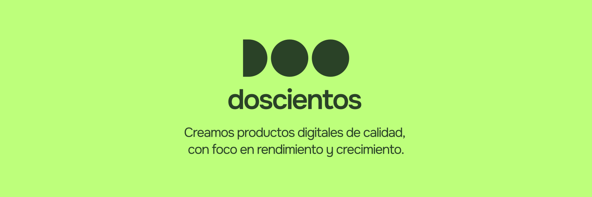

  
   
  <a href="https://doscientos.es">doscientos.es</a>
  &nbsp;·&nbsp;
  <a href="mailto:hola@doscientos.es">Hablemos</a>
  &nbsp;·&nbsp;
  <a href="https://www.linkedin.com/company/doscientos">LinkedIn</a>

## Software útil para negocios reales

Somos un estudio de software en Barcelona. Diseñamos y desarrollamos sistemas a medida, productos digitales y automatizaciones para que las empresas trabajen con menos fricción.

En esta organización encontrarás productos propios y herramientas reutilizables que construimos y usamos en nuestros proyectos.

## Proyectos destacados

<table>
  <tr>
    <td width="50%" valign="top">
      <h3><a href="https://github.com/doscientos-es/abaco">Ábaco</a></h3>
      
Gestión para autónomos y empresas de servicios: clientes, presupuestos, visitas, trabajo de campo y seguimiento de facturas y cobros.

    </td>
    <td width="50%" valign="top">
      <h3><a href="https://github.com/doscientos-es/ui">@doscientos/ui</a></h3>
      
Primitives React accesibles, rápidas y temables para los productos de Doscientos.

    </td>
  </tr>
  <tr>
    <td width="50%" valign="top">
      <h3><a href="https://github.com/doscientos-es/skills">Doscientos Skills</a></h3>
      
Skills reutilizables para asistentes de código, con guías técnicas y de ecosistema.

    </td>
    <td width="50%" valign="top">
      <h3><a href="https://github.com/doscientos-es/changelog">Changelog</a></h3>
      
CLI sin dependencias para generar changelogs.

    </td>
  </tr>
</table>

  <a href="https://github.com/orgs/doscientos-es/repositories">Explora todos nuestros repositorios</a>
  &nbsp;·&nbsp;
  <a href="https://doscientos.es">Conoce doscientos</a>

